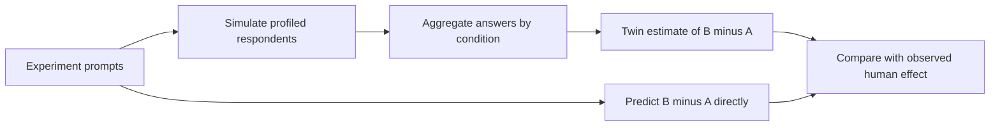
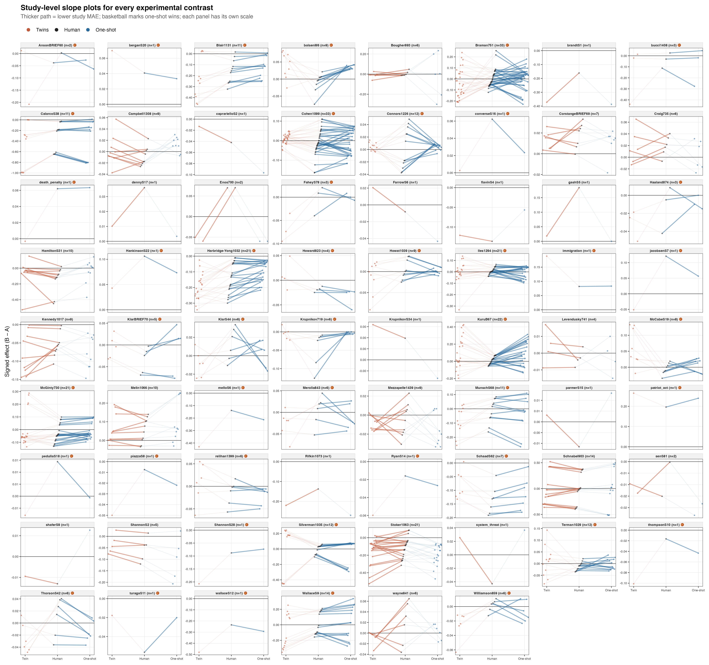

# Direct One-Shot Forecasts and Respondent-Twin Simulations

This repository compares two ways to predict the average effect of a social
science experiment: simulate respondent-level answers and aggregate them, or
predict the treatment effect directly in one shot. It reproduces a six-page
note using 469 contrasts from 70 experiments. The benchmark archive and
respondent-twin forecasts come from [Ashokkumar, Hewitt, Ghezae, and Willer
(2026)](https://doi.org/10.1038/s41586-026-10742-x).

[Read the paper (PDF)](note.pdf) · [View the 469-contrast figure (PDF)](study_slope_grid.pdf)

## Research question

Do respondent twins improve forecasts of aggregate experimental effects
relative to direct one-shot predictions?

The comparison is a reanalysis and extension of the archive assembled by
Ashokkumar et al. Their study used GPT-4 to answer original experiment
materials as demographically profiled simulated respondents, then aggregated
answers within experimental conditions to estimate treatment effects. Here,
we retain the archive's human outcomes and GPT-4 twin estimates and add
forecasts from GPT-6 Astra, Claude Fable 5, and Gemini 4 Argon. For each case,
the one-shot model receives selected survey prompts for both conditions and
predicts the normalized mean difference directly.

| Route | Forecast construction |
| --- | --- |
| Respondent twins | Simulate profiled respondents under each condition, then aggregate their answers to estimate the difference. |
| One-shot | Read selected survey prompts for both conditions and directly predict the normalized mean difference. |

## Results

All forecasts are scored against the same observed contrasts. Lower mean
absolute error (MAE) is better.

| Forecast | MAE | RMSE | Sign accuracy |
| --- | ---: | ---: | ---: |
| Original GPT-4 respondent twins | 0.0735 | 0.1071 | 69.1% |
| GPT-6 Astra, one-shot | 0.0560 | 0.0766 | 70.6% |
| Claude Fable 5, one-shot | 0.0556 | 0.0819 | 70.1% |
| Gemini 4 Argon, one-shot | 0.0551 | 0.0811 | 69.7% |
| Equal mean of three one-shots | **0.0532** | 0.0762 | 69.9% |
| Study-held-out weighted mean | 0.0535 | 0.0776 | 70.8% |

The equal one-shot mean reduces MAE by 0.0202 outcome units relative to the
archived twins (study-cluster bootstrap 95% interval for one-shot minus twins:
[-0.0327, -0.0080]). The direct forecasts' advantage is mostly about effect
magnitude: their sign accuracy is close to that of the twins. Study-held-out
weights do not improve on the simple equal mean.

The one-shot mean has lower MAE in each of the five groups formed by observed
effect magnitude. The gap is small for the smallest effects and widens across
the larger-effect groups; these are descriptive groups, not preregistered
subgroup tests.

## Every contrast, by experiment

Each panel below is one experiment. Every connected path shows the original
twin estimate, the human result, and the mean one-shot estimate for one of the
469 contrasts. The lower-MAE path within each experiment is emphasized, and
each panel has its own vertical scale. The plot is intended as a diagnostic
overview; use the linked PDF to zoom into individual panels.

[Open the full-size figure](study_slope_grid.pdf)

## Interpretation and limitations

For an aggregate point forecast in this archive, the direct one-shot prompts
are a strong and simpler baseline. The comparison does not show that respondent
simulation is generally unnecessary. Twins retain respondent-level answers
and can estimate joint response distributions when simulated respondents are
linked across conditions or questions. Those distributions may support
questions about heterogeneity and mechanisms that a point forecast cannot
answer; their fidelity was not evaluated here.

The comparison evaluates forecasting systems rather than isolating the value
of the simulation step. The twins use GPT-4, while the one-shot forecasts use
newer models and different prompts. The 70 archived experiments are also a
limited basis for claims about new studies or populations. A prospective,
model-matched evaluation should compare both aggregate accuracy and
distributional fidelity.

## Reproduce the analysis

From this directory, run make.

The build regenerates analysis tables, the all-contrast figure, and the PDF,
then checks citations, references, and page count. It uses the vendored
analysis-ready archive subset, exact one-shot prompts, and stored forecasts, so
the build does not call model APIs or require inference credentials.

Install Python dependencies with python -m pip install -r requirements.txt.
The plot also requires R with ggplot2 3.5 or newer, ragg, and png; the paper
build requires GNU Make and TeX Live (pdflatex and BibTeX). See
[data/README.md](data/README.md) for data provenance and scope.
